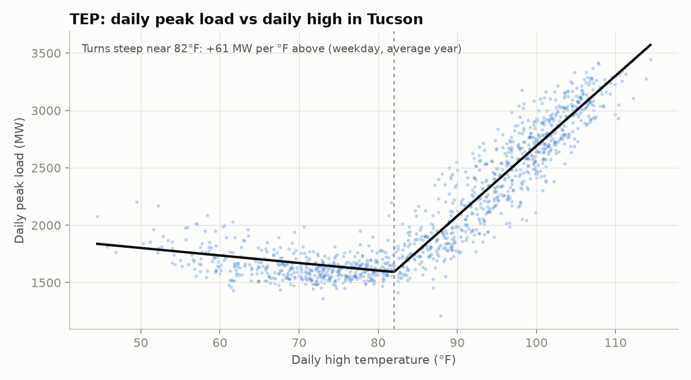
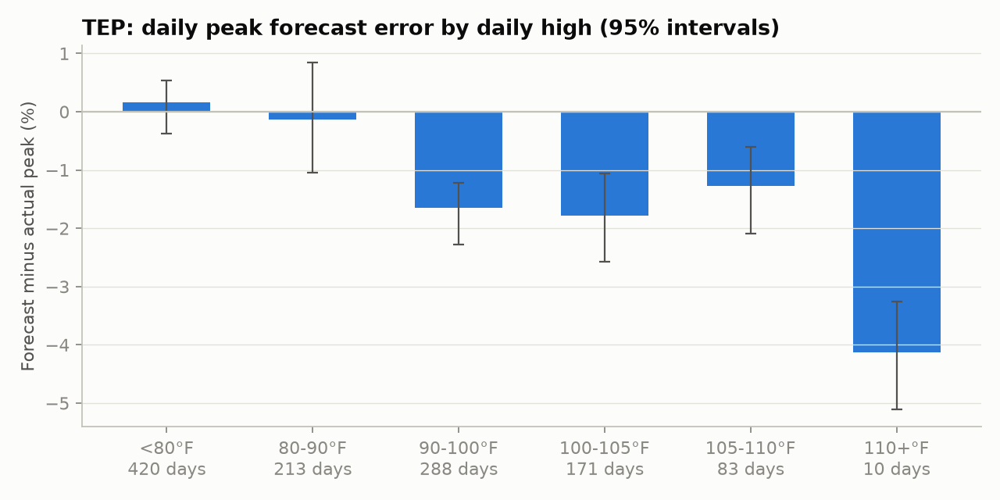
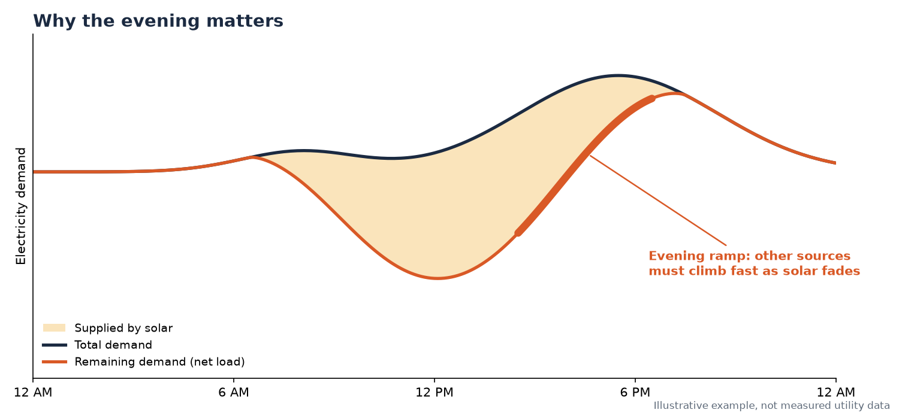
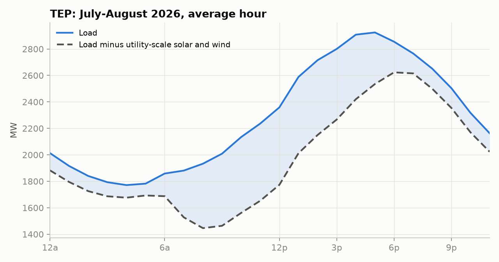
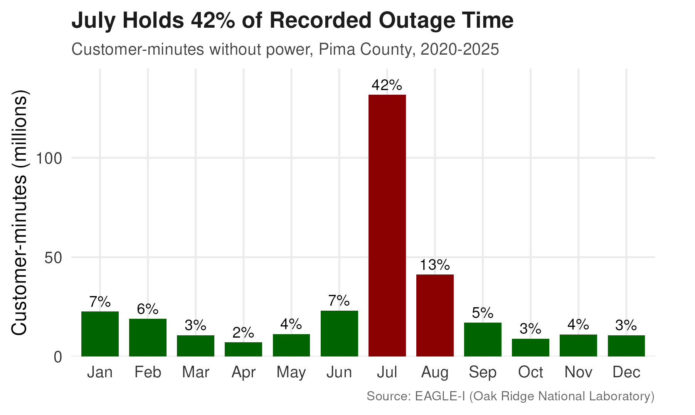
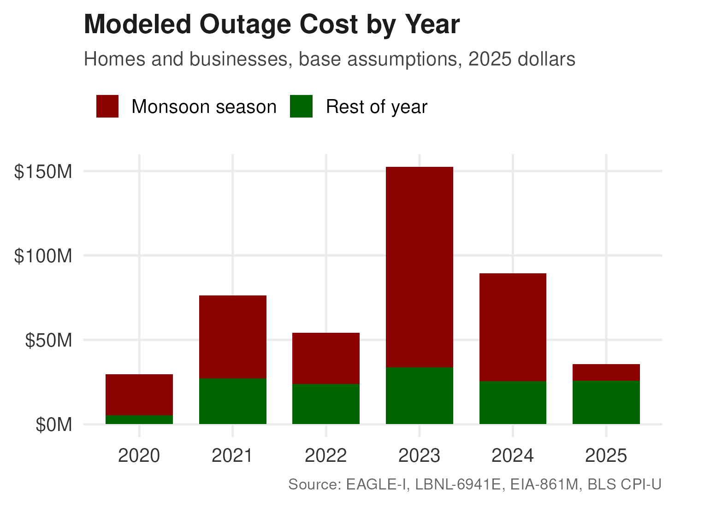
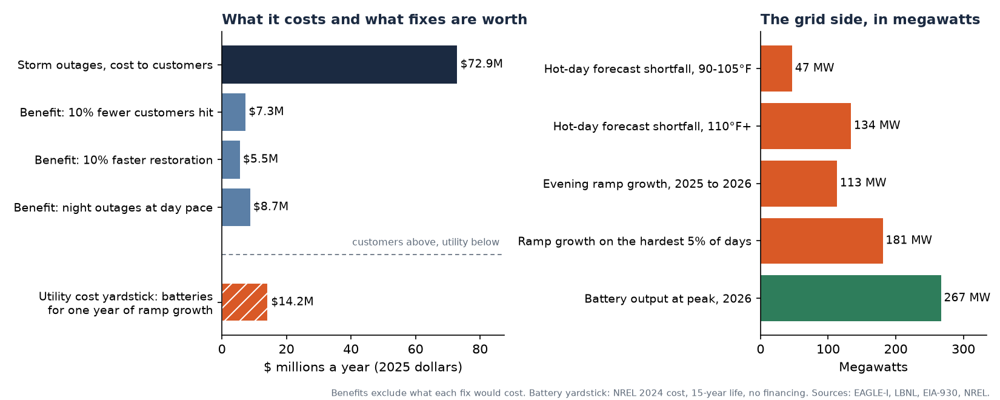

# What Summer Costs Tucson's Grid: Heat, Storms and Where the Money Goes

**Jake Moore** · November 2026 · Public data only: EIA-930 hourly grid data, EIA-861 sales and reliability, Oak Ridge
National Laboratory's EAGLE-I outage counts, NOAA storm reports, Open-Meteo weather, Lawrence Berkeley National
Laboratory's outage cost study, and NREL's battery cost benchmark. Not prepared with, for, or using any information
from Tucson Electric Power.

## Bottom line

Summer hits Tucson's electric grid from two sides. Heat pushes demand up, and monsoon storms knock customers out.

- **Storm outages are the biggest measurable cost.** Power outages cost Pima County's homes and businesses an
  estimated $72.9 million a year from 2020 to 2025 (range $38 million to $143 million, depending mostly on how many
  of those affected are businesses). July alone holds 42% of all outage time.
- **The improvements are worth millions a year each.** Interrupting 10% fewer customers per storm would be worth
  about $7.3 million a year to customers; restoring every outage 10% faster, about $5.5 million; restoring night
  outages as fast as daytime ones, up to $8.7 million. These are benefits only. What each improvement would cost to
  achieve is not public.
- **On the demand side, the pressure is timing, not growth.** After accounting for weather, Tucson's demand grew just
  1.7% from 2024 to 2026. But as solar farms produced 67% more in 2026 (January to early November, against the same months of 2025), the evening climb that other power sources must
  cover grew by 113 megawatts in a single year. Covering that one year of growth with batteries would cost on the
  order of $14 million a year.
- **The forecast is reliable except on hot afternoons.** TEP's day-ahead demand forecast misses by 2.9% an hour on
  average, but on 90-105°F days it comes in about 47 megawatts short of the actual peak, and about 134 megawatts short
  on the rare 110°F days.

## 1. Heat drives the peak

Electricity demand (the industry calls it **load**) follows the afternoon temperature. Below about 82°F, heat barely
moves it. Above 82°F, air conditioning takes over, and every extra degree adds about 61 megawatts (MW) to the day's
highest hour, the **peak**. A megawatt measures power being used at one moment; on an average hot summer day TEP's
peak is 2,780 MW.

- Temperature explains 91% of the day-to-day swings in the summer peak, and the response has held steady at about
  59-64 MW per degree in each year since 2024.
- Two-thirds of summer days (67%) peak in the 5-6 PM hour.
- A hot night adds about a quarter as much as a hot afternoon.

**How well is the peak predicted?** Each day the utility publishes a **day-ahead forecast**: its prediction of demand
for every hour of the next day. Since August 2023 it has missed by 2.87% an hour on average (95% range 2.68-3.09%),
which is accurate, and it doesn't lean high or low overall. The problem is concentrated in heat.

| Daily high | Days | Forecast peak minus actual peak | Days the forecast was 3%+ too low |
|---|---|---|---|
| Under 80°F | 420 | +0.2% | 10% |
| 90-100°F | 288 | -1.7% | 35% |
| 100-105°F | 171 | -1.8% | 37% |
| 110°F+ | 10 | -4.1% | 60% |

On the 459 days between 90°F and 105°F, the forecast peak averages 1.7% low, about 47 MW. On the ten 110°F+ days,
4.1% low, about 134 MW at a 110°F peak. A wrong weather forecast explains little of it: hot days come in above
forecast even when the temperature was called correctly.

## 2. Solar is moving the hard hour later

During the day, large solar farms supply part of the power people use. In the evening their output falls while homes
and businesses still need power, so gas and coal plants, batteries and power from outside the area must pick up the
difference fast. The demand left after solar and wind is called **net load**, and its climb at sunset is the
**evening ramp**.

| | 2024 | 2025 | 2026 (to Nov 2) |
|---|---|---|---|
| Average output of large solar farms (MW) | 112 | 113 | 198 |
| Share of midday demand met by large solar farms | 19% | 20% | 31% |
| Average daily largest 3-hour rise in net load (MW) | 531 | 530 | 644 |
| The same rise on the hardest 5% of days (MW) | 687 | 687 | 868 |
| Average time of the net-load peak, summer | 5:08 PM | 5:29 PM | 6:10 PM |

Demand itself is barely growing: after accounting for weather, average demand rose 1.7% from 2024 to 2026, and TEP's
own sales grew 1.4% from 2022 to 2025. What changed is when power is needed. The net-load peak moved from about 5:30
to after 6 PM in one year, and the average evening climb grew 113 MW (181 MW on the hardest days). Battery output in
the 100 highest-demand hours reached 267 MW in 2026.

## 3. Storms knock customers out

**When do outages happen?** Pima County's outage records come in 15-minute counts of customers without power. Measured
in customer-minutes (one customer without power for one minute), July holds 42% of all outage time from 2020 to 2025,
and June 15 to September 30 holds 66%.

**What does it cost?** Lawrence Berkeley National Laboratory publishes what an interruption costs a home, a small
business and a large business, by outage length. Weighted by TEP's customer mix and moved to 2025 dollars:

- Outages cost Pima County an estimated **$72.9 million a year**, $49.3 million of it in monsoon season. The worst
  year was $152.3 million.
- Homes are nine customers in ten but only 4% of the cost. Businesses carry the rest, so the estimate depends most on
  how many of the customers interrupted are businesses. Halving or doubling that share moves the total from
  $38 million to $143 million.

**What makes a bad night?** A "big outage night" is one with 5,000 or more customers out at once.

- Humidity sets up the storm. In monsoon season, big nights followed a median noon dew point of 58.9°F, against
  52.8°F before normal nights.
- Night outages last 39% longer on average than daytime ones of the same size and weather (95% range 20% to 61%).
- By 3 PM, a two-input model (dew point and daily high) separated big nights from normal ones well on 2024-2025
  (score 0.89 on a 0 to 1 scale where 0.5 is a coin flip), but only 15% of its flags were real big nights, and in
  earlier years it ranged from 0.50 to 0.85. The signal looks real, not proven.

## 4. Where the money goes

The two halves of the problem are measured differently. Storm outages have a price: what interruptions cost
customers. The grid side is measured in megawatts. To put them on the same page without forcing one ranking, this
section shows both, and adds a battery yardstick to the megawatts.

**The battery yardstick.** NREL puts the 2024 cost of a 4-hour utility battery at $334 per kilowatt-hour of storage,
which is $1,371 per kilowatt of power in 2025 dollars. Spread over its 15-year life, plus 2.5% a year for upkeep,
that is about $126 per kilowatt each year. It leaves out financing, so it is a floor, and a battery is one tool among
several (gas plants, imports and demand response also cover a ramp).

| Summer problem | What it costs or how big it is | One fix and what it's worth or costs (2025 dollars, per year) |
|---|---|---|
| Storm outages | $72.9M a year to customers (range $38M-$143M) | 10% fewer customers hit: $7.3M benefit. 10% faster restoration: $5.5M. Night outages at day pace: $8.7M ($4.7M if only half the gap closes). Fix cost not public |
| Evening ramp | +113 MW in one year (+181 MW on the hardest days) | Batteries sized to one year's growth: about $14.2M a year ($22.7M for the hardest days); $155M up front |
| Hot-day forecast | 47 MW short on 90-105°F days; 134 MW on 110°F+ days | A forecasting fix, not a build. No public price |

## What this means

- **Storm outages are the largest dollar figure on the table.** At $72.9 million a year to customers, the improvements
  priced here are worth $5.5 million to $8.7 million a year each, before counting what they cost to achieve.
- **The grid's new pressure is the evening, and it is growing fast.** One year of solar growth added a ramp that would
  take about $14 million a year in batteries to cover. Demand is barely growing; the hour when other power is needed
  is moving from about 5:30 to after 6 PM.
- **The forecast gap is a modeling problem, not a construction one.** A peak forecast that runs 47 MW short on most
  hot days, and 134 MW on the hottest, is fixed in the model, not by building anything.
- **Both problems land on summer evenings.** July holds 42% of outage time and storms build from mid-afternoon,
  while the net-load peak now comes after 6 PM.

What public data can't answer: what each improvement would cost TEP to achieve, how TEP's own load model treats heat
and rooftop solar, and how its planned batteries cover the 6 PM peak.

## How the numbers were made

- **Two areas.** Demand figures cover TEP's grid area (EIA-930 balancing area TEPC, which also serves other utilities'
  customers; TEP's own sales are 62% of its energy). Outage figures cover Pima County (EAGLE-I), which TEP serves most
  of.
- **Windows.** Forecast scored from August 2023, after a reporting change; growth compared from 2024; outages 2020-2025.
- **Ranges** come from resampling whole blocks of days or events, since misses and storms cluster.
- **Dollars.** Outage costs are LBNL 2013 dollars moved to 2025 with CPI-U. The battery yardstick is NREL's 2024 cost
  (Cole, Ramasamy and Turan, NREL/TP-6A40-93281, June 2025) moved to 2025 with CPI-U, straight-line over 15 years plus
  2.5% fixed upkeep (2024 ATB), no financing cost.
- **Appendices.** The full [peak-demand memos](peak/peak_demand_memos.html) (TEP, APS, SRP and an Arizona comparison)
  and the 12-section [outage paper](outages/storm_outage_cost_jakemoore.pdf) with all four models.
- **Reproduce.** `python pull.py`, then `python peak/analysis.py`, the outage paper's `build_paper.ps1` and
  `Rscript deck/deck_charts.R`, then `python combine.py`. Every number above is in `results.json`.
