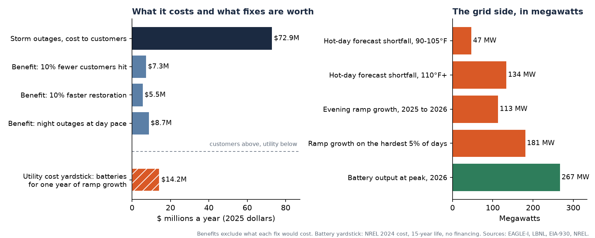

# What Summer Costs Tucson's Grid: Heat, Storms and Where the Money Goes

Summer hits Tucson's electric grid from two sides. Heat pushes demand up, and monsoon storms knock customers out. This
project measures both with public data, then puts them on one page: the storm side in dollars, the heat side in
megawatts, with a battery cost yardstick to bridge the two.

**The question:** What does summer cost Tucson's electric grid, from the heat on one side and storms on the other, and
where would money do the most good?

## Bottom line

- **Storm outages are the biggest measurable cost.** Power outages cost Pima County's homes and businesses an
  estimated $72.9 million a year from 2020 to 2025 (range $38 million to $143 million, depending mostly on how many of
  those affected are businesses). July alone holds 42% of all outage time.
- **The improvements are worth millions a year each.** Interrupting 10% fewer customers per storm would be worth about
  $7.3 million a year to customers; restoring every outage 10% faster, about $5.5 million; restoring night outages as
  fast as daytime ones, up to $8.7 million. These are benefits only. What each improvement would cost to achieve is
  not public.
- **On the demand side, the pressure is timing, not growth.** After accounting for weather, Tucson's demand grew just
  1.7% from 2024 to 2026. But as solar farms produced 67% more in 2026 (January to early November, against the same
  months of 2025), the evening climb that other power sources must cover grew by 113 megawatts in a single year.
  Covering that one year of growth with batteries would cost on the order of $14 million a year.
- **The forecast is reliable except on hot afternoons.** TEP's day-ahead demand forecast misses by 2.9% an hour on
  average, but on 90-105°F days it comes in about 47 megawatts short of the actual peak, and about 134 megawatts short
  on the rare 110°F days.



| Summer problem | What it costs or how big it is | One fix and what it's worth or costs (2025 dollars, per year) |
|---|---|---|
| Storm outages | $72.9M a year to customers (range $38M-$143M) | 10% fewer customers hit: $7.3M benefit. 10% faster restoration: $5.5M. Night outages at day pace: $8.7M ($4.7M if only half the gap closes). Fix cost not public |
| Evening ramp | +113 MW in one year (+181 MW on the hardest days) | Batteries sized to one year's growth: about $14.2M a year ($22.7M for the hardest days); $155M up front |
| Hot-day forecast | 47 MW short on 90-105°F days; 134 MW on 110°F+ days | A forecasting fix, not a build. No public price |

## What's here

| Path | What |
|---|---|
| `MEMO.md`, `tucson_grid_memo.pdf` | The combined memo, 8 pages, written for a business reader |
| `results.json` | Every number in the memo, deck and this page |
| `peak/` | Demand study (Python, DuckDB SQL): heat response, day-ahead forecast accuracy, solar and the evening ramp, for TEP with APS and SRP for comparison |
| `outages/` | Storm study (R): outage cost, timing, restoration and big-night models for Pima County, as a full paper |
| `combine.py` | Joins both halves into `results.json` and draws the Act 4 chart |
| `check_numbers.py` | Confirms every number in a document traces to `results.json` |
| `deck/` | Slide deck, a 10-minute version and the talk tracks |

## How to run

Python 3 with pandas, duckdb, matplotlib, requests, openpyxl, markdown and python-pptx; R with the packages loaded at
the top of `outages/storm_outage_cost_jakemoore.Rmd`; Google Chrome for printing the PDFs.

```
python pull.py                      # re-pulls both halves; --outages re-streams EAGLE-I (about 7 GB)
python peak/analysis.py             # demand study: builds the DuckDB database, results and charts
cd outages
powershell -File build_paper.ps1    # knits the outage paper to HTML and PDF
Rscript deck/deck_charts.R          # outage charts and numbers
cd ..
python combine.py                   # one results.json and the Act 4 chart
python check_numbers.py             # must print OK, 0 unmatched
python build_memo.py                # memo HTML and PDF
python deck/build_grid_deck.py      # full deck; add --mini for the 10-minute version
```

## Data sources

| Source | Used for |
|---|---|
| [EIA-930](https://www.eia.gov/electricity/gridmonitor/) hourly grid data | Demand, day-ahead forecast and generation by fuel for TEP's balancing area (TEPC), APS and SRP |
| [EIA-861](https://www.eia.gov/electricity/data/eia861/) | Retail sales, customer counts and reliability filings |
| [Open-Meteo](https://open-meteo.com/) | Hourly Tucson temperature, dew point, rain and wind, and the archived day-ahead temperature forecast |
| [EAGLE-I](https://eagle-i.doe.gov/), Oak Ridge National Laboratory; yearly files on figshare 24237376 | Customers without power in Pima County every 15 minutes, 2020-2025 (CC BY 4.0) |
| [NOAA Storm Events Database](https://www.ncei.noaa.gov/stormevents/) | Storm reports used to check outage timing |
| [Lawrence Berkeley National Laboratory](https://emp.lbl.gov/publications/updated-value-service-reliability), LBNL-6941E (Sullivan et al., 2015) | Cost of an interruption for homes and businesses, by outage length |
| [BLS CPI-U](https://www.bls.gov/cpi/) | Moving 2013 and 2024 dollars to 2025 dollars |
| [NREL, NREL/TP-6A40-93281](https://docs.nlr.gov/docs/fy25osti/93281.pdf) (Cole, Ramasamy and Turan, June 2025), with the 2024 ATB | The battery cost yardstick: $334 per kilowatt-hour for a 4-hour system |

## Limits

- **2026 is partial.** The data cut is Nov 2, 2026. Solar growth compares the same January-to-November 2 window in both
  years.
- **The battery yardstick is a floor.** Straight-line over a 15-year life plus 2.5% a year for upkeep, with no
  financing cost. Batteries are one tool among several; gas plants, imports and demand response also cover a ramp.
- **Benefits exclude fix cost.** The outage figures are what each improvement would be worth to customers, not what it
  would cost to achieve. That cost is not public.
- **Two different areas.** Demand covers TEP's balancing area, which also serves other utilities' customers; outages
  cover Pima County, which includes Trico Electric Cooperative's customers.
- **Public data only.** Not affiliated with, endorsed by, or prepared using any information from Tucson Electric Power,
  APS, SRP or Trico Electric Cooperative.

Jake Moore · Management Information Systems, University of Arizona ·
[LinkedIn](https://www.linkedin.com/in/jake-moore74/) · Jakemoore@arizona.edu
