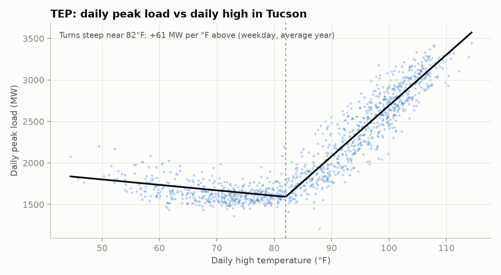
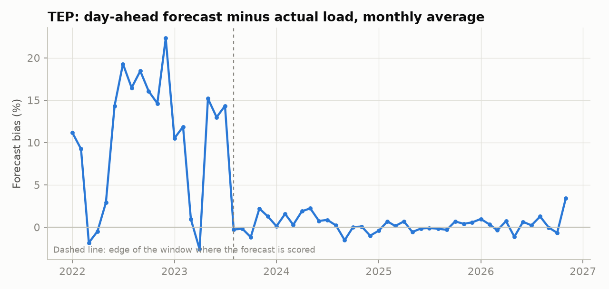
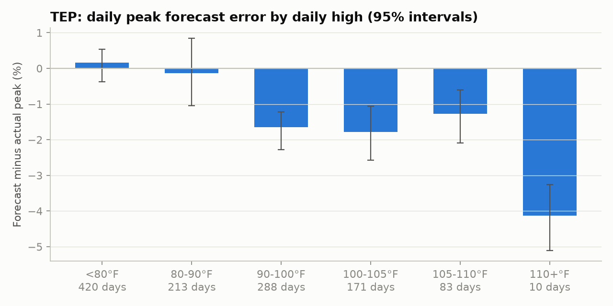
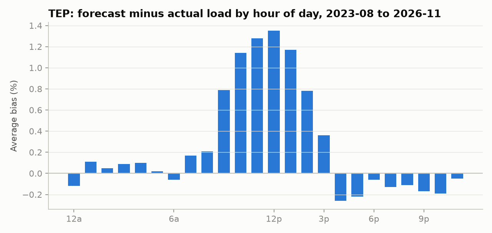
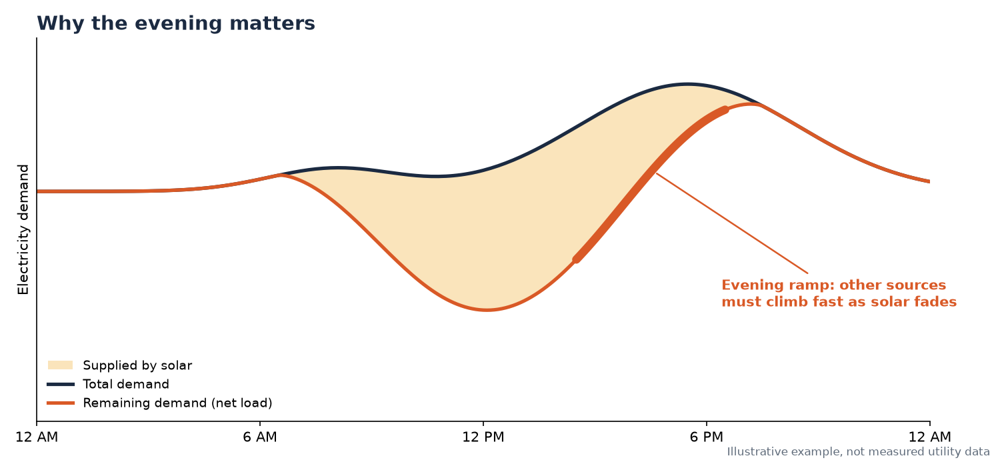
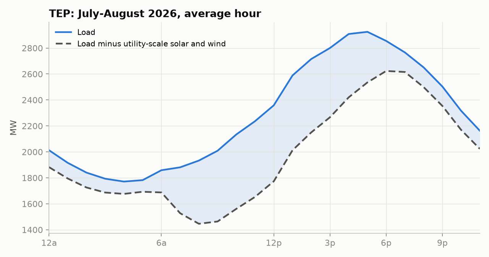

# Tucson Electric Power: Peak Demand, Forecast Accuracy and the Evening Ramp

**Jake Moore** · November 2026 · Public data only: EIA-930 hourly grid data (Jan 2022 to Nov 2, 2026), EIA-861 annual
sales and reliability (2019-2025), Open-Meteo observed and archived forecast weather for central Tucson.
Not prepared with, for, or using any information from Tucson Electric Power. Companion memos: [APS](MEMO_APS.md),
[SRP](MEMO_SRP.md), [Arizona comparison](MEMO_ARIZONA.md).

## Bottom line

- **Electricity demand is barely growing.** After accounting for differences in weather, average demand rose just 1.7%
  from 2024 to 2026, and TEP's own electricity sales grew 1.4% from 2022 to 2025. The Phoenix utilities are growing
  several times faster.
- **The forecast is accurate, but runs low on hot afternoons.** Since August 2023, TEP's day-ahead predictions of
  hourly demand have been off by about 2.9% on average. That matches SRP and beats APS over a period all three can be
  compared on. On 90-105°F days, TEP typically predicts a daily peak about 1.7% below what actually occurs, even when the
  weather forecast was right.
- **Rooftop solar may be changing the shape of demand.** The forecast runs slightly high from 10 AM to 2 PM and slightly
  low from 4 to 6 PM. That is the pattern you would expect as home solar panels cut how much power customers draw from
  the grid in the middle of the day.
- **The evening is the hardest part of the day to supply.** Output from large solar farms rose 67% in the first ten months of 2026, against the same months of 2025. When the
  sun sets, other sources have to replace that power quickly. The average daily three-hour climb in the power those
  other sources must supply grew from 530 MW to 644 MW in one year, and it now peaks around 6 PM.

## 1. What drives the peak

Demand (the industry calls it **load**) tracks the afternoon temperature closely. Below about 82°F, heat barely moves
it. Above 82°F, air conditioning takes over and every extra degree adds about 61 megawatts (MW) to the day's highest
hour, the **peak**. A megawatt measures power being used at one moment; TEP's hot-day peak averages 2,780 MW.

| Measure (Aug 2023 on, year-to-year growth removed) | Result |
|---|---|
| Temperature where demand starts climbing steeply | 82°F (temperature explains 91% of the day-to-day swings in the peak) |
| Added peak for each °F above 82°F | +61 MW, 2.2% of an average hot summer-day peak (2,780 MW) |
| Summer days, one factor at a time: per °F of daily high / overnight low / dew point | +46 / +12 / +7 MW |
| Weekend or federal holiday, same weather | -28 MW |
| Added peak per °F above 82°F, by year: 2024 / 2025 / 2026 | 64 / 59 / 63 MW (stable) |
| Summer days peaking in the 5-6 PM hour | 67% (4-5 PM: 15%) |
| Third day or later of a heat wave (highs of 106.8°F+), beyond what that day's weather explains | +29 MW, from 5 heat waves (range +7 to +40) |
| Hours within 5% of the year's highest demand: 2023 / 2024 / 2025 / 2026 | 15 / 13 / 12 / 23 |

A hot night adds about a quarter as much as a hot afternoon. Long heat waves appear to build demand a little beyond
each day's own temperature, but five events are too few to call that settled.

## 2. How good the day-ahead forecast is

Each day the utility publishes a **day-ahead forecast**: its prediction of demand for every hour of the next day. The
standard yardstick is the average size of the hourly miss, in percent (**MAPE**, mean absolute percentage error).

Before August 2023 the published forecast ran about 13% above actual demand in a typical month, then dropped to near
zero and stayed there. That looks like a change in how the numbers are reported, so the forecast is scored from August
2023 on (see the notes at the end).

| Aug 2023 to Nov 2026 | Result |
|---|---|
| Average hourly miss (MAPE), with 95% range | 2.87% (2.68-3.09) |
| Average lean: positive means the forecast runs high | +0.26% (+0.02 to +0.54) |
| Average hourly miss by year: 2023 (Aug-Dec) / 2024 / 2025 / 2026 | 3.1% / 3.0% / 2.5% / 3.0% |
| Summer days where the forecast picks the exact peak hour / within one hour | 62% / 88% |
| Daily peak miss, weekdays vs weekends and holidays | -0.9% vs -0.4% |

The miss depends on the heat. On mild days the forecast is on target; from 90°F up it predicts too little.

| Daily high | Days | Forecast peak minus actual peak | 95% range | Days the forecast was 3%+ too low |
|---|---|---|---|---|
| Under 80°F | 420 | +0.2% | -0.4 to +0.5 | 10% |
| 80-90°F | 213 | -0.1% | -1.1 to +0.8 | 23% |
| 90-100°F | 288 | -1.7% | -2.3 to -1.2 | 35% |
| 100-105°F | 171 | -1.8% | -2.6 to -1.1 | 37% |
| 105-110°F | 83 | -1.3% | -2.1 to -0.6 | 21% |
| 110°F+ | 10 | -4.1% | -5.1 to -3.3 | 60% |

- **A wrong weather forecast explains little of it.** Using the public weather model's prediction for the same day,
  days that turned out 3°F+ hotter than forecast (44 days) missed the peak by -2.4%, days within 3°F (333) by -1.5%,
  and days 3°F+ cooler (50) by -0.6%. Even with the weather called correctly, hot days come in above forecast.
- **The misses don't repeat from one day to the next.** Today's miss has almost no relationship with the miss two days
  earlier (correlation 0.13), so adjusting today's forecast by recent misses barely helps: tested on Mar 2025-Nov 2026,
  it moves the average miss from 2.74% to 2.72%. What remains is how demand responds to heat.

## 3. Growth once weather is removed

A hot year uses more power than a mild one, so raw totals overstate or hide real growth. **Weather-adjusted demand**
estimates what each year would have used under the same weather, so years can be compared fairly.

| | 2022 | 2023 | 2024 | 2025 | 2026 (to Nov 2) |
|---|---|---|---|---|---|
| Average demand, weather-adjusted (MW, July-type weekday) | 2,011 | 2,069 | 2,109 | 2,111 | 2,145 |
| Peak on a 110°F weekday, weather-adjusted (MW) | 3,094 | 3,133 | 3,176 | 3,187 | 3,255 |
| Actual highest demand of the year (MW) | 3,019 | 3,419 | 3,319 | 3,448 | 3,416 |

- 2024 to 2026: average demand +1.7%, peak on a 110°F day +2.5%. The 2022-2023 figures straddle the August 2023
  reporting change, so the clean comparison starts in 2024.
- TEP's electricity sales to its own customers grew 1.4% from 2022 to 2025 (residential +1.0%, commercial +2.7%,
  industrial +1.2%) while its customer count grew 3.1%. Those sales were 62% of the energy used in TEP's grid area in
  2025; the area also serves other utilities' customers.

## 4. Solar and the evening ramp

During the day, large solar farms supply part of the power people use. In the evening, solar output falls while homes
and businesses still need power, so other sources (gas and coal plants, batteries, power from outside the area) must
ramp up fast. The demand left after solar and wind is called **net load**, and its rise as the sun sets is the
**evening ramp**.

| | 2022 | 2023 | 2024 | 2025 | 2026 (to Nov 2) |
|---|---|---|---|---|---|
| Average output of large solar farms (MW) | 122 | 117 | 112 | 113 | 198 |
| Share of demand met by large solar farms, 11 AM-2 PM | 22% | 20% | 19% | 20% | 31% |
| Average daily largest 3-hour rise in net load (MW) | 517 | 541 | 531 | 530 | 644 |
| The same rise on the hardest 5% of days (MW) | 734 | 786 | 687 | 687 | 868 |
| Average time of the net-load peak, summer | 4:51 PM | 5:38 PM | 5:08 PM | 5:29 PM | 6:10 PM |

Rooftop solar is invisible in this data: it lowers measured demand before the grid sees it, so the real ramp is
larger than shown. In July-August 2026, net load bottomed at 1,446 MW at 8 AM and peaked at 2,623 MW at 6 PM.

## 5. What supplies the peak

| 100 highest-demand hours of the year | 2024 | 2025 | 2026 (to Nov 2) |
|---|---|---|---|
| Demand (MW) | 3,035 | 3,145 | 3,184 |
| Gas / coal (MW) | 1,534 / 579 | 1,388 / 640 | 1,361 / 567 |
| Solar / wind (MW) | 195 / 104 | 172 / 118 | 289 / 103 |
| Battery (MW; reported from Jan 2025) | not reported | 110 | 267 |
| Power flowing in from outside the area (MW, share of demand) | 616 (20%) | 717 (23%) | 597 (19%) |

About a fifth of the power at peak arrives from outside TEP's grid area. That figure is physical flow, so it includes
output from distant plants TEP owns or contracts, not only power bought on the market.

## 6. Reliability

| Per customer, per year (EIA-861) | 2023 | 2024 | 2025 |
|---|---|---|---|
| Minutes without power, normal days (major storms excluded) | 61.9 | 68.4 | 41.8 |
| Minutes without power, all days | 168.7 | 113.2 | 41.8 |
| Minutes added by major events | 106.8 | 44.8 | 0 |
| Number of outages, all days | 0.98 | 0.99 | 0.65 |
| Average outage length, all days (minutes) | 173 | 114 | 65 |

## What this means

- **Hot afternoons carry the forecasting risk.** The forecast is reliable on mild days and runs about 2% low from 90°F
  up, with the right weather in hand, and 4% low on the rare 110°F days. Demand keeps climbing about 61 MW per degree
  in the heat. That pattern is what a utility would check first when it plans how much reserve power to hold.
- **Solar is shifting the hard hours later.** Midday demand comes in below forecast and late afternoon above it, and the
  net-load peak moved from about 5 PM to 6 PM as solar farm output jumped. Battery output in the top hours rose from
  110 to 267 MW in a year, which is the tool built for exactly that shift.
- **Growth is not the pressure in Tucson. Timing is.** With demand nearly flat, the cost question is meeting the same
  peak at a later, steeper hour rather than adding capacity for growth.
- **Outages come from storms.** Normal-day outage time is low; the bad years, 2023 and 2024, came from major events.
  The companion outage study prices that risk.

What public data can't answer: how TEP's own load model treats extreme heat and rooftop solar, and how much of the
6 PM peak its batteries are planned to cover.

## How the numbers were made

- **Scope.** The hourly figures cover TEP's whole grid area, which is wider than TEP's own customers (62% of 2025
  energy). Sales and reliability figures are for TEP itself.
- **Reporting change.** The biggest single shift in the monthly forecast lean falls in March 2023 (11.8% before, 1.2%
  after), but the lean returned to 13-15% from May to July 2023 and stayed near zero from August 2023, when in-area gas
  output also doubled. Scoring starts in August 2023.
- **Data checks (42,408 hours).** No duplicate or missing hours; 120 hours without a forecast; 74 hours where EIA
  filled in demand itself; 269 hours where the forecast equals actual demand and 196 where it equals the prior day's
  (all kept); demand matches generation minus net flow within 2% in all but 5 hours.
- **Methods.** Hot days are chosen by temperature. Ranges come from resampling 14-day blocks of days, since misses
  cluster, and heat-wave ranges resample whole events. Growth comes from a model of daily demand on heating and cooling
  need, weekday and holiday, with a separate level for each year. The weather check uses the archived public forecast
  model; TEP's own weather forecast is not public.
- **Reproduce.** `python pull.py && python analysis.py`; every number is in `results.json` under `TEP`.
