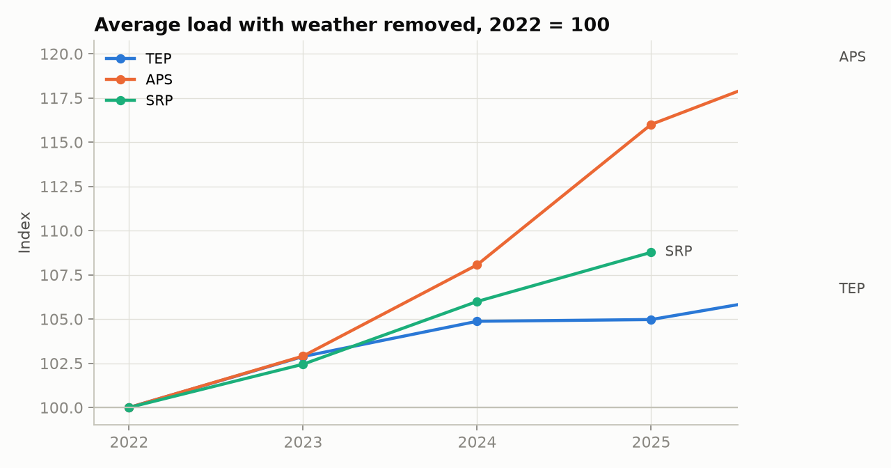
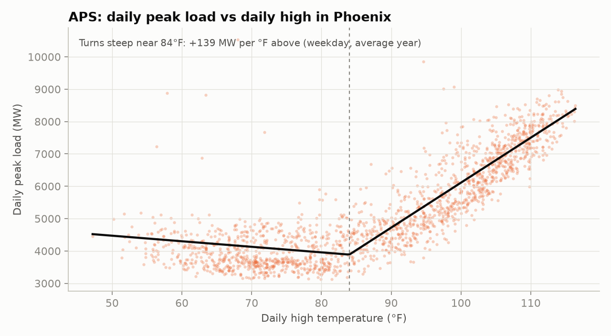
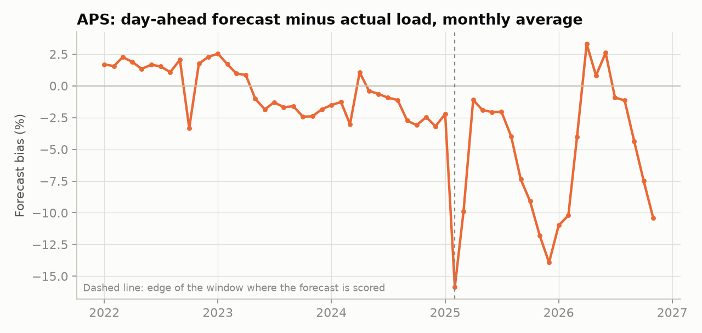
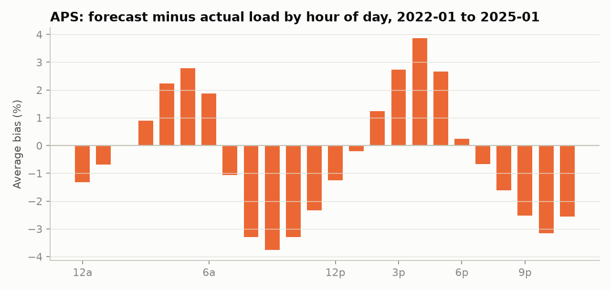
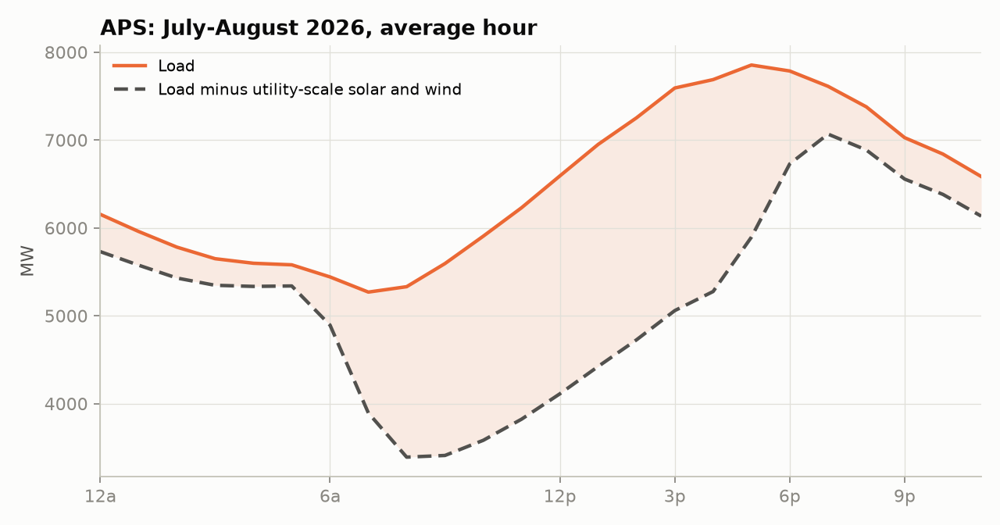
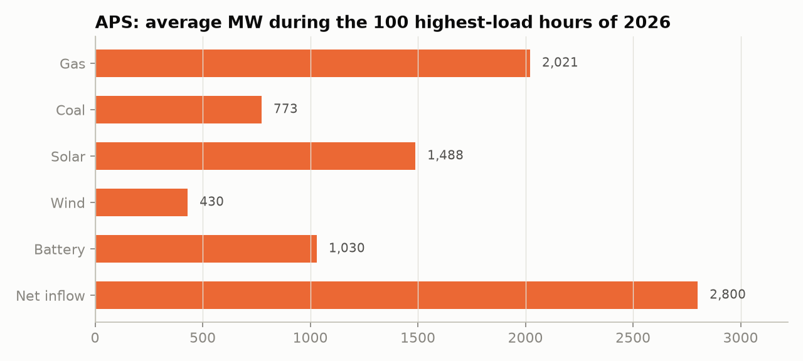

# Arizona Public Service: Fast Growth, a 2025 Forecast Gap, and a Doubled Evening Ramp

**Jake Moore** · November 2026 · Public data only: EIA-930 hourly grid data for the area APS manages (Jan 2022 to
Nov 2, 2026), EIA-861 annual sales and reliability (2019-2025), Open-Meteo weather for Phoenix Sky Harbor.
Not prepared with, for, or using any information from APS. Companion memos: [TEP](MEMO.md), [SRP](MEMO_SRP.md),
[Arizona comparison](MEMO_ARIZONA.md).

## Bottom line

- **Demand is growing faster here than anywhere else in Arizona's three big grid areas.** After accounting for
  weather, demand in the area APS manages rose 8.1% from 2022 to 2024, in line with APS's own sales, then another 7.3%
  in 2025 alone.
- **The 2025 jump doesn't show up in APS's own sales.** APS's electricity sales rose only 1.5% in 2025. Most of that
  year's increase is either power used in the area by customers other than APS's, or a change in what the reported
  demand figure covers.
- **Something changed in February 2025.** Overnight, reported demand jumped about 600 MW above the forecast in a single
  month and has stayed 450-700 MW above it since. Before the change the forecast missed by about 3.8% an hour on
  average; afterward, 9.9%. Public data does not say why.
- **The evening ramp has doubled.** Large solar farms now supply 42% of midday demand. As their output falls in the
  evening, other sources must replace it. The average daily three-hour climb in that remaining demand rose from 996 MW
  in 2022 to 2,104 MW in 2026, and it peaks near 7 PM.

## 1. Growth once weather is removed

APS reports to the federal grid data as a **balancing area**: a section of the grid where one operator keeps supply
and demand matched every moment. The AZPS area includes APS's customers and some other users. **Weather-adjusted
demand** estimates what each year would have used under the same weather, so years compare fairly.

| | 2022 | 2023 | 2024 | 2025 | 2026 (to Nov 2) |
|---|---|---|---|---|---|
| Average demand, weather-adjusted (MW, July-type weekday) | 4,711 | 4,848 | 5,091 | 5,465 | 5,642 |
| Peak on a 110°F weekday, weather-adjusted (MW) | 6,985 | 7,199 | 7,327 | 7,700 | 8,046 |
| Actual highest demand of the year (MW) | 8,531 | 9,854 | 9,020 | 10,529 | 9,071 |

| APS sales to its own customers (EIA-861) | 2022 to 2024 | 2024 to 2025 |
|---|---|---|
| Total | +10.4% | +1.5% |
| Commercial | +17.8% | +7.9% (about 144 MW on average) |
| Residential / industrial | +5.6% / -3.3% | -4.2% / -5.5% |
| Energy used in the whole AZPS area (EIA-930) | +12.4% | +7.9% |

Through 2024, area growth tracked APS's own sales. In 2025 the area added about 337 MW of average demand while APS's
commercial sales added about 144 MW and its other customer classes fell. APS's own sales were 88% of the area's 2025
energy.

On a July-August 2025 day, the area's overnight low was still 66.5% of its peak hour, against 59-60% for TEP and SRP.
A large share of demand in the AZPS area runs around the clock instead of rising and falling with the afternoon heat.

## 2. How heat drives the peak

| Measure (year-to-year growth removed) | Result |
|---|---|
| Temperature where demand starts climbing steeply | 84°F (temperature explains 88% of the day-to-day swings in the peak) |
| Added peak for each °F above 84°F | +139 MW, 2.0% of an average hot summer-day peak (6,860 MW) |
| Summer days, one factor at a time: per °F of daily high / overnight low / dew point | +114 / +10 / +24 MW |
| Weekend or federal holiday, same weather | -54 MW |
| Third day or later of a heat wave (highs 111.7°F+), beyond that day's weather | +122 MW, from 9 heat waves (range +4 to +173) |
| Summer days peaking 5-6 PM / 6-7 PM | 57% / 24% |
| Hours within 5% of the year's highest demand, 2022-2025 / 2026 | 1-3 per year / 22 |

Long heat waves appear to build demand beyond each day's own temperature; nine events are too few to call it settled.
APS's record peaks are very brief: until 2026, only 1 to 3 hours a year came within 5% of the annual high.

## 3. The day-ahead forecast

The **day-ahead forecast** is the utility's published prediction of demand for each hour of the next day. Its
accuracy is measured as the average size of the hourly miss (**MAPE**). Because of the February 2025 change, it is
scored in two parts.

**January 2022 to January 2025, before the change**

| | Result |
|---|---|
| Average hourly miss (MAPE), with 95% range | 3.82% (3.60-4.01) |
| Average lean: negative means the forecast runs low | -0.38% (-0.84 to +0.07) |
| Average hourly miss by year: 2022 / 2023 / 2024 | 3.7% / 3.5% / 4.1% |
| Daily peak miss by temperature | within ±0.3% in every band, from under 80°F to 110°F+ |
| Summer days where the forecast picks the exact peak hour / within one hour | 56% / 90% |
| Shape through the day | about 3.8% low at 9 AM and 3.9% high at 4 PM |

The low-morning, high-afternoon shape fits solar timing: measured demand falls later in the morning and recovers
earlier in the afternoon than the forecast expects.

**February 2025 to November 2026, after the change (forecast against reported demand)**

| | Result |
|---|---|
| Average hourly miss / average lean | 9.9% (9.1-10.6) / -5.3% (-6.7 to -3.6) |
| Lean by hour | -11% to -15% from 9 PM to 3 AM; +5.5% at 4 PM |
| Daily peak miss: under 80°F / 100°F+ days | -8.7% / +2.5% to +3.1% |
| Exact peak hour / within one hour, summer | 13% / 68% |
| How closely today's miss matches the miss two days earlier (correlation) | 0.79 |
| Adjusting by recent misses, set on Feb-Dec 2025 and tested on Dec 2025-Nov 2026 | average miss 9.30% to 7.64% |

The gap behaves like a steady block of demand that appears in reported demand but not in the forecast: largest at
night and in cooler months, partly offset in summer afternoons when the forecast runs high. Because it persists day to
day, simply adjusting each forecast by recent misses removes about a fifth of the error.

## 4. Solar and the evening ramp

During the day, large solar farms supply part of the power people use. In the evening their output falls while demand
stays high, so gas plants, batteries and imports must ramp up fast. The demand left after solar and wind is called
**net load**, and its climb at sunset is the **evening ramp**.

| | 2022 | 2023 | 2024 | 2025 | 2026 (to Nov 2) |
|---|---|---|---|---|---|
| Average output of large solar farms (MW) | 187 | 197 | 340 | 590 | 791 |
| Share of demand met by large solar farms, 11 AM-2 PM | 13% | 13% | 22% | 35% | 42% |
| Average daily largest 3-hour rise in net load (MW) | 996 | 1,087 | 1,237 | 1,771 | 2,104 |
| The same rise on the hardest 5% of days (MW) | 1,264 | 1,374 | 1,640 | 2,256 | 3,078 |
| Average time of the net-load peak, summer | 5:34 PM | 5:57 PM | 6:27 PM | 6:34 PM | 6:35 PM |

In July-August 2026, net load fell to 3,391 MW at 8 AM and climbed to 7,067 MW at 7 PM: a 3,700 MW swing every summer
day, before counting rooftop solar, which lowers measured demand before the grid sees it.

## 5. What supplies the peak

| 100 highest-demand hours of the year | 2023 | 2024 | 2025 | 2026 (to Nov 2) |
|---|---|---|---|---|
| Demand (MW) | 7,925 | 7,818 | 7,922 | 8,483 |
| Gas / coal (MW) | 2,433 / 1,188 | 1,904 / 1,184 | 1,945 / 1,033 | 2,021 / 773 |
| Solar / wind (MW) | 406 / 178 | 600 / 197 | 1,003 / 232 | 1,488 / 430 |
| Battery (MW; reported from Mar 2025) | not reported | not reported | 926 | 1,030 |
| Power flowing in from outside the area (MW, share of demand) | 3,627 (46%) | 3,560 (46%) | 2,782 (35%) | 2,800 (33%) |

Coal at the peak fell by a third since 2023 while solar nearly quadrupled and batteries passed 1,000 MW. The area
still draws a third of its peak power from outside its boundary; that includes APS's own distant plants as well as
purchases.

## 6. Reliability

| Per customer, per year (EIA-861) | 2019 | 2022 | 2023 | 2024 | 2025 |
|---|---|---|---|---|---|
| Minutes without power, normal days (major storms excluded) | 86.8 | 84.0 | 82.1 | 80.9 | 73.1 |
| Minutes without power, all days | 118.6 | 138.1 | 98.6 | 87.2 | 73.1 |
| Average outage length, all days (minutes) | 124 | 133 | 112 | 94 | 87 |

Normal-day outage time has improved every year since 2021 and is down 16% from 2019.

## What this means

- **Growth is the story, and part of it sits outside APS's own customers.** Through 2024 the area grew with APS's
  commercial sales. In 2025 the area added about 337 MW of average demand that APS's sales account for only about
  144 MW of, with a flat, around-the-clock profile.
- **The February 2025 gap makes the public forecast hard to use.** A steady 450-700 MW overnight difference between
  forecast and reported demand means anyone using these public figures for planning or analysis needs to know which
  number to trust. Because the gap repeats day to day, adjusting by recent misses already cuts the error by a fifth.
- **The evening is now the hardest stretch of the day.** The average three-hour climb at sunset doubled to about
  2,100 MW, and on the hardest days passes 3,000 MW. Batteries supply about 1,000 MW at peak, the fastest-growing
  tool for covering it.
- **Reliability keeps improving** on normal days, year after year.

What public data can't answer: what caused the February 2025 step, whether that demand is in APS's own planning
forecast, and how the 7 PM ramp is covered on the hardest days.

## How the numbers were made

- **Scope.** AZPS is a balancing area; APS's own sales were 88% of its 2025 energy. APS also serves Yuma, Flagstaff
  and Prescott; this analysis uses Phoenix weather, where most of the demand is.
- **Windows.** The forecast is scored like-for-like through January 2025; the single largest shift in the monthly
  forecast lean falls in February 2025 (-0.4% before, -5.5% after). Later months are reported separately above.
- **Data checks (42,408 hours).** No duplicate or missing hours, no missing forecasts, 18 hours where EIA filled in
  demand itself, 33 hours where demand and generation minus net flow differ by more than 2%.
- **Ranges** come from resampling 14-day blocks of days, since misses cluster; heat-wave ranges resample whole events.
- **Reproduce.** `python pull.py && python analysis.py`; every number is in `results.json` under `APS`.
