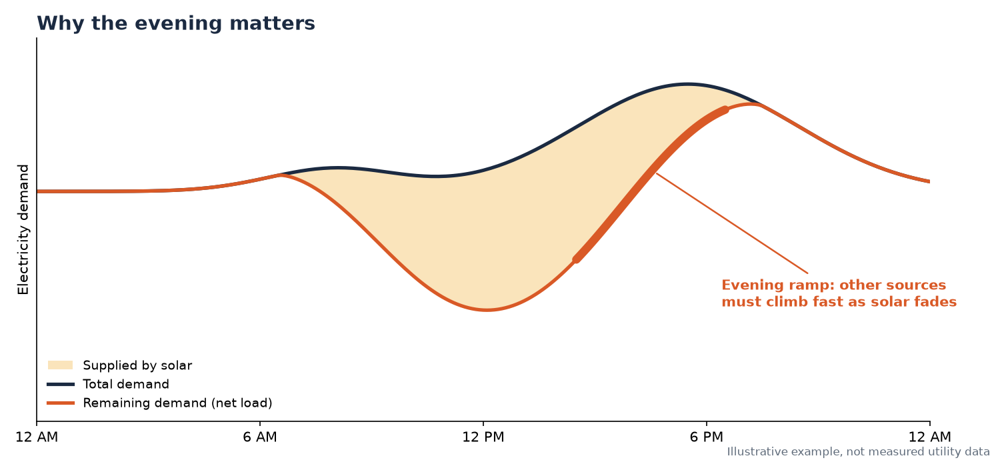
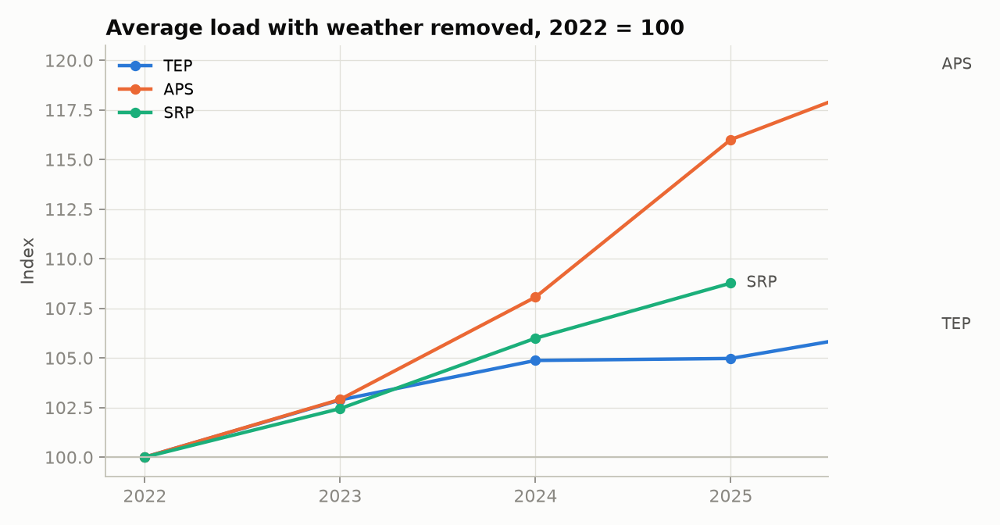
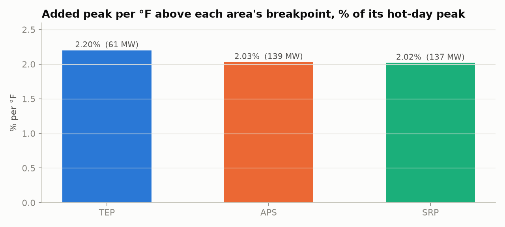
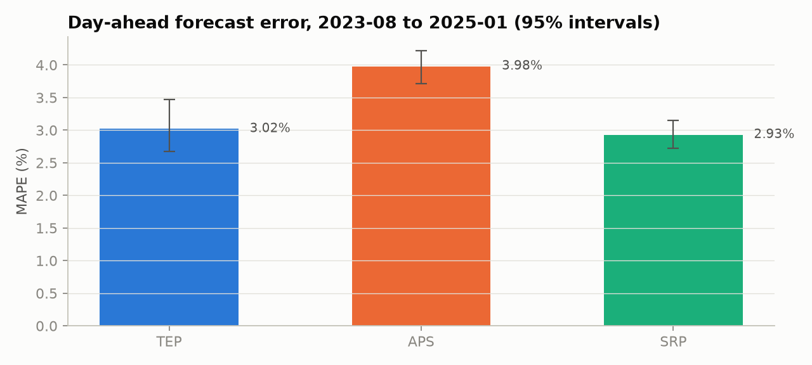
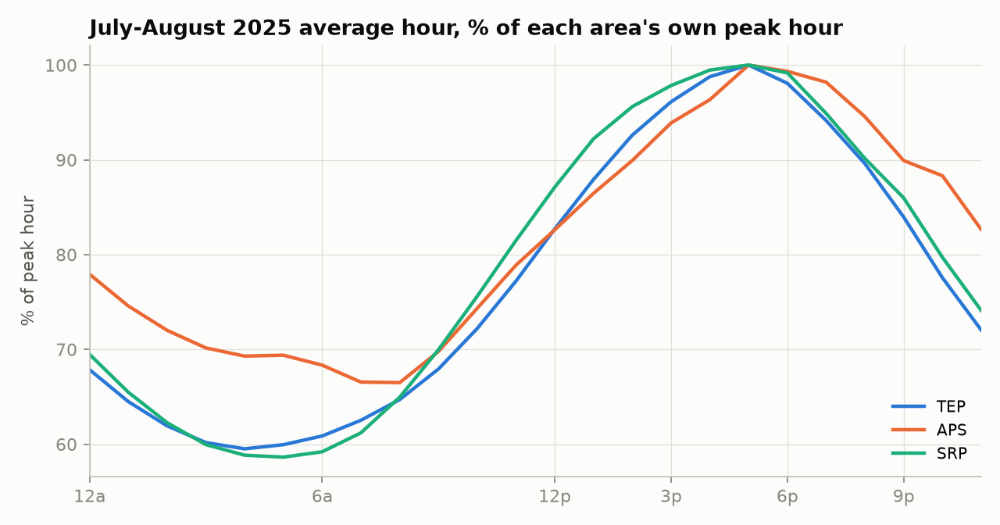

# Arizona's Three Large Grids: TEP, APS and SRP Side by Side

**Jake Moore** · November 2026 · Public data only: EIA-930 hourly grid data (Jan 2022 to Nov 2, 2026), EIA-861
annual sales and reliability (2019-2025), Open-Meteo weather for Tucson and Phoenix.
Detailed memos: [TEP](MEMO.md), [APS](MEMO_APS.md), [SRP](MEMO_SRP.md).

## Bottom line

- **Same heat, different growth.** All three grid areas respond to heat the same way: peak demand rises about 2% for
  every degree above 80-84°F. But underlying growth differs widely. After accounting for weather, demand since 2024
  grew 10.8% in the APS area (through Nov 2026), 2.6% in the SRP area (through 2025) and 1.7% in the TEP area
  (through Nov 2026).
- **Everyone needs power at the same time.** All three usually hit their summer high between 5 and 6 PM, and their
  daily peaks move closely together. A statewide heat wave tightens every system in the same hour.
- **Forecasting skill is close.** Over the period all three can be compared on, TEP and SRP predicted hourly demand
  within about 3% on average, APS within about 4%. Since February 2025, APS's forecast and its reported demand have
  split apart by 450-700 MW overnight, for reasons the public data doesn't show.
- **Solar is changing when other power is needed, fastest in the APS area.** As solar output falls in the evening,
  batteries, power plants and imports must make up the difference. In the APS area that average three-hour climb has
  doubled since 2022 to 2,104 MW; TEP's is 644 MW and SRP's 1,002 MW.

## Key terms

| Term | What it means here |
|---|---|
| Load, demand | How much electricity is being used at a given moment |
| Peak | The highest demand in a period, usually one hour of a summer afternoon |
| Megawatt (MW) | Power being used or produced at one moment. 1 MW = 1,000 kilowatts |
| Balancing area | A section of the grid where one operator keeps supply and demand matched. It can include more than one utility's customers and plants |
| Day-ahead forecast | The utility's published prediction of demand for each hour of the next day |
| MAPE | The average size of the hourly forecast miss, in percent |
| Weather-adjusted demand | What a year would have used under the same weather, so years compare fairly |
| Net load | Demand minus output from large solar and wind farms: what other sources must supply |
| Evening ramp | The fast rise in net load as solar output falls toward sunset |

## Side by side

| Measure | TEP | APS | SRP |
|---|---|---|---|
| Customers, 2025 | 0.46 million | 1.43 million | 1.19 million |
| Temperature where demand starts climbing steeply | 82°F | 84°F | 80.5°F |
| Added peak per °F above it (MW / % of hot-day peak) | 61 / 2.2% | 139 / 2.0% | 137 / 2.0% |
| Added peak per °F of overnight low, summer (MW) | 12 | 10 | 28 |
| Third day or later of a heat wave, beyond that day's weather (MW; events) | +29 (5) | +122 (9) | +118 (6) |
| Weather-adjusted average demand, 2024 to latest | +1.7% (to Nov 2026) | +10.8% (to Nov 2026) | +2.6% (to 2025) |
| Weather-adjusted average demand, 2022 to 2025 | +5.0%, across TEP's 2023 reporting change | +16.0% | +8.8% |
| Utility's own sales 2022-2025 (2024-2025) | +1.4% (-0.3%) | +12.0% (+1.5%) | +10.1% (+2.4%) |
| Overnight low as % of peak hour, July-August 2025 | 59.5% | 66.5% | 58.6% |
| Average hourly forecast miss, Aug 2023-Jan 2025 (95% range) | 3.02% (2.67-3.47) | 3.98% (3.71-4.22) | 2.93% (2.72-3.15) |
| Average hourly forecast miss, each utility's own clean window | 2.87% (Aug 2023-Nov 2026) | 3.82% (2022-Jan 2025) | 3.16% (2022-Feb 2026) |
| Share of midday demand met by large solar farms, latest summer | 31% (2026) | 42% (2026) | 21% (2025) |
| Average daily 3-hour evening ramp, latest year | 644 MW (2026) | 2,104 MW (2026) | 1,002 MW (2025) |
| Ramp as % of the year's highest demand | 19% | 23% | 11% |
| Battery output in the 100 highest-demand hours, latest year | 267 MW | 1,030 MW | 205 MW |
| Power flow at the 100 highest-demand hours, latest year | 19% of demand flows in | 33% flows in | 32% flows out |
| Minutes without power per customer, normal days, 2025 | 41.8 | 73.1 | 49.9 |

Heat-wave figures rest on 5-9 events each, so treat them as suggestive.

## 1. Growth

The APS area's growth through 2024 tracked APS's own sales, led by commercial customers. In 2025 the area added about
337 MW of average demand while APS's sales rose 1.5%, so most of that year's jump is either power used in the area by
others, or a change in what the reported demand covers. Demand in the APS area stays at two-thirds of its peak
overnight, seven points above TEP and SRP. SRP's growth comes from businesses, with industrial (+15.2%) as well as
commercial (+18.6%) sales rising from 2022 to 2025. TEP's own sales are flat.

## 2. Heat

Scaled to their size, the three respond to daytime heat almost identically. They differ at night: per degree,
Phoenix's overnight lows matter almost three times as much for SRP as for APS.

## 3. Forecasting

| Day-by-day difference in forecast miss, Aug 2023-Jan 2025 | Average (percentage points) | 95% range |
|---|---|---|
| TEP minus SRP | +0.09 | -0.35 to +0.65 (no measurable difference) |
| TEP minus APS | -0.96 | -1.40 to -0.45 |
| SRP minus APS | -1.05 | -1.30 to -0.76 |

Each forecast misses in its own way. TEP's is on target overall and runs low only on hot afternoons. SRP's runs about
1.5% low in every hour of every month, and its miss has grown each year. APS's ran about 4% low at 9 AM and 4% high
at 4 PM before 2025, and since February 2025 it sits well below reported demand overnight.

## 4. The shared peak hour

- Of each area's 20 highest-demand days since 2022, TEP and SRP share 8, SRP and APS 7, TEP and APS 5, and all three
  share 3.
- Summer daily peaks move together (correlation 0.87 TEP-SRP, 0.83 TEP-APS, 0.90 SRP-APS), and all three average
  their peak in the 5-6 PM hour.
- At their own peaks, the TEP and APS areas draw power in from outside while the SRP area sends power out. These are
  physical flows, which include jointly owned and distant plants.

## What this means

- **Arizona's grids face the same heat but different futures.** The APS area is growing about six times as fast as
  TEP's since 2024, and much of the newest growth runs around the clock. Planning for Phoenix and planning for Tucson
  are different problems.
- **Shared peaks limit how much neighbors can help.** When all three hit their high in the same hour on the same days,
  the power each area imports at peak competes with its neighbors' needs.
- **The evening, not the afternoon, is becoming the hard hour.** Solar keeps pushing the moment of greatest need for
  other power later and higher, most of all in the APS area, where the evening climb is now a quarter of the year's
  peak. Batteries supply about 1,000 MW at peak in the APS area, 270 MW at TEP and 200 MW at SRP.
- **The public forecasts need care before use.** Each has a reporting break, and APS's 2025 gap is unexplained. Anyone
  comparing utilities on public data has to pick clean windows first, as this analysis does.

## How the numbers were made

- Grid-area figures (EIA-930) cover more than each utility's own customers: the utility's own sales were 62% of TEP's
  2025 area energy, 88% of APS's and 94.5% of SRP's. Comparisons use each area in its own terms (percent of its own
  peak) instead of dividing by customers.
- Each forecast series has its own reporting break, so clean windows differ: TEP from August 2023, APS through
  January 2025, SRP through February 2026. The period all three share is August 2023 to January 2025.
- Weather is central Tucson for TEP and Phoenix Sky Harbor for APS and SRP. APS also serves Yuma and northern Arizona.
- Rooftop solar lowers measured demand before the grid sees it, so true evening ramps are larger than shown.
- Ranges come from resampling 14-day blocks of days, because forecast misses cluster; heat-wave ranges resample
  events.
- Reproduce with `python pull.py && python analysis.py`; the comparison numbers are in `results.json` under `arizona`.
