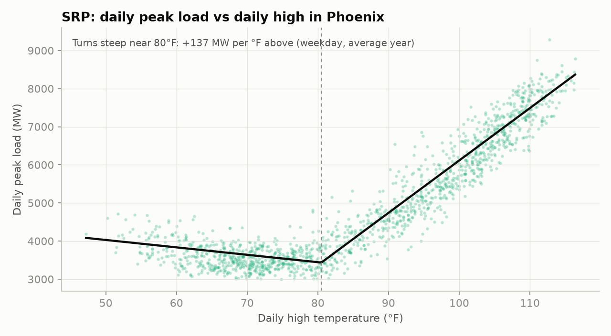
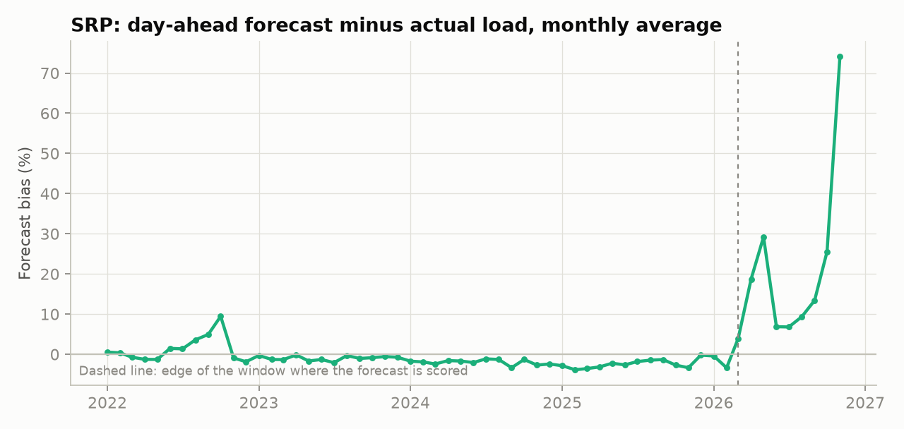
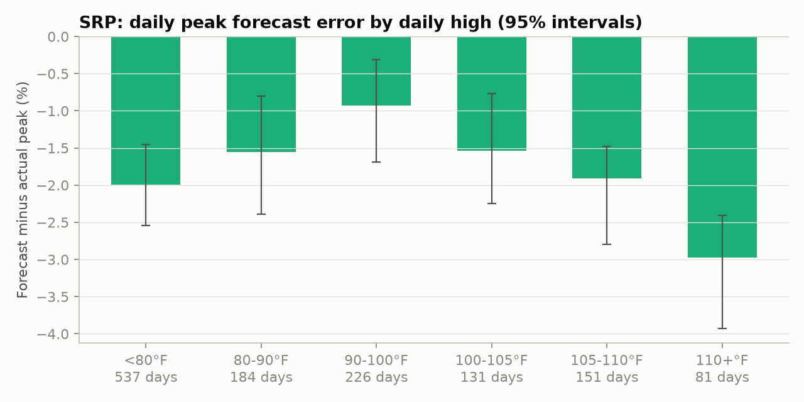
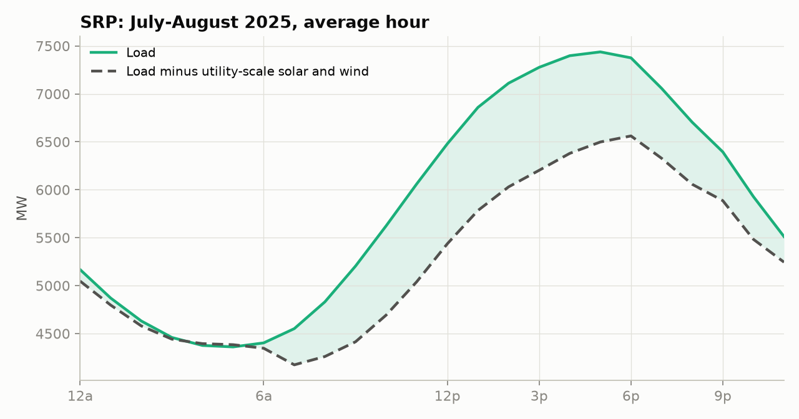
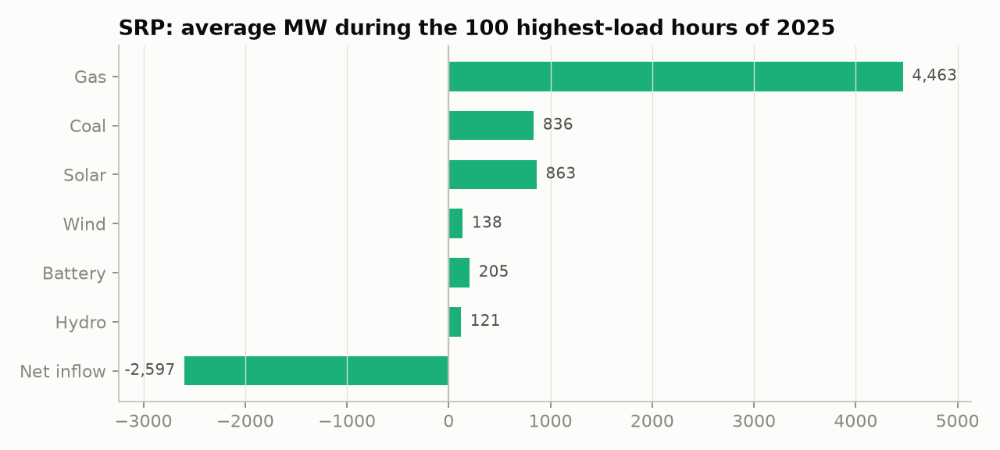

# Salt River Project: Business-Led Growth, a Forecast That Runs Low, and a 2026 Reporting Change

**Jake Moore** · November 2026 · Public data only: EIA-930 hourly grid data for the area SRP manages (Jan 2022 to
Nov 2, 2026), EIA-861 annual sales and reliability (2019-2025), Open-Meteo weather for Phoenix Sky Harbor.
Not prepared with, for, or using any information from SRP. Companion memos: [TEP](MEMO.md), [APS](MEMO_APS.md),
[Arizona comparison](MEMO_ARIZONA.md).

## Bottom line

- **Business growth is driving demand.** After accounting for weather, average demand rose 8.8% from 2022 to 2025.
  SRP's sales to commercial customers grew 18.6% and to industrial customers 15.2%, while residential sales grew 1.4%.
- **The forecast is accurate but consistently predicts too little.** From January 2022 to February 2026, SRP's
  day-ahead predictions of hourly demand were off by about 3.2% on average and came in about 1.5% low in every hour of
  every month. The miss has grown each year, and it is largest in extreme heat: on 110°F+ days the forecast peak runs
  3.0% low, and half of those days come in more than 3% above forecast.
- **Hot nights matter more at SRP.** Overnight temperature has a stronger effect on peak demand at SRP than at the other
  two Arizona utilities. On hot days, electricity use stays high after the sun goes down.
- **Reliability is strong.** On normal days (major storms excluded), SRP customers averaged roughly 41-53 minutes
  without power a year from 2019 to 2025, the lowest of the three utilities in most years.
- **A change in reported demand clouds 2026.** From March 2026, the forecast sits 340-580 MW above reported demand in
  every hour of the day. A flat gap across all 24 hours points to a change in what the demand figure covers, so those
  months are left out of the forecast scoring and growth figures.

## 1. Growth once weather is removed

A hot year uses more power than a mild one. **Weather-adjusted demand** estimates what each year would have used under
the same weather, so years compare fairly.

| | 2022 | 2023 | 2024 | 2025 |
|---|---|---|---|---|
| Average demand, weather-adjusted (MW, July-type weekday) | 4,822 | 4,940 | 5,111 | 5,245 |
| Peak on a 110°F weekday, weather-adjusted (MW) | 7,162 | 7,305 | 7,437 | 7,654 |
| Actual highest demand of the year (MW) | 7,629 | 9,283 | 8,356 | 8,784 |

| SRP sales to its own customers, 2022 to 2025 (EIA-861) | Change |
|---|---|
| Total | +10.1% |
| Commercial / residential / industrial | +18.6% / +1.4% / +15.2% |
| Customers | +6.2% (1.19 million in 2025) |
| Energy used in SRP's whole grid area (EIA-930) | +12.2% |

SRP's own sales were 94.5% of the energy used in its grid area in 2025, so the area figures track SRP's customers
closely.

## 2. How heat drives the peak

Demand (the industry calls it **load**) tracks temperature. Above a breakpoint near 80°F, air conditioning takes over
and every extra degree adds to the day's highest hour, the **peak**.

| Measure (Jan 2022 to Feb 2026, year-to-year growth removed) | Result |
|---|---|
| Temperature where demand starts climbing steeply | 80.5°F (temperature explains 95% of the day-to-day swings in the peak) |
| Added peak for each °F above it | +137 MW, 2.0% of an average hot summer-day peak (6,791 MW) |
| Summer days, one factor at a time: per °F of daily high / overnight low / dew point | +101 / +28 / +16 MW |
| Weekend or federal holiday, same weather | -64 MW |
| Added peak per °F, by year: 2022 / 2023 / 2024 / 2025 | 125 / 142 / 147 / 137 MW |
| Third day or later of a heat wave (111.7°F+), beyond that day's weather | +118 MW, from 6 heat waves (range +6 to +184) |
| Summer days peaking 4-5 PM / 5-6 PM | 33% / 43% |

Each degree of overnight low adds 28 MW at SRP, more than a quarter of the daytime effect and the most of the three
utilities.

## 3. The day-ahead forecast

The **day-ahead forecast** is the utility's published prediction of demand for each hour of the next day. Accuracy is
the average size of the hourly miss (**MAPE**).

| Jan 2022 to Feb 2026 | Result |
|---|---|
| Average hourly miss (MAPE), with 95% range | 3.16% (2.99-3.37) |
| Average lean: negative means the forecast runs low | -1.51% (-1.79 to -1.22); low in every hour and every calendar month |
| Average hourly miss by year: 2022 / 2023 / 2024 / 2025 | 2.4% / 2.7% / 3.1% / 3.9% |
| Summer days where the forecast picks the exact peak hour / within one hour | 38% / 85% |
| Hours with no published forecast | 4,475 (11% of hours; daily peak scoring uses full days only) |

| Daily high | Days | Forecast peak minus actual peak | 95% range | Days the forecast was 3%+ too low |
|---|---|---|---|---|
| Under 80°F | 537 | -2.0% | -2.5 to -1.5 | 35% |
| 90-100°F | 226 | -0.9% | -1.7 to -0.3 | 27% |
| 100-105°F | 131 | -1.5% | -2.3 to -0.8 | 34% |
| 105-110°F | 151 | -1.9% | -2.8 to -1.5 | 39% |
| 110°F+ | 81 | -3.0% | -3.9 to -2.4 | 52% |

- **The miss is growing.** The average hourly miss rose every year, from 2.4% in 2022 to 3.9% in 2025, as demand grew
  about 3% a year.
- **The low lean is steady.** It is deepest at night (-2.7% at 11 PM) and smallest at midday (-0.8%).
- **Misses partly repeat.** Today's miss is moderately related to the miss two days earlier (correlation 0.48).
  Adjusting each forecast by recent misses, set on 2022-Feb 2024 and tested on Feb 2024-Feb 2026, cuts the average miss
  from 3.60% to 3.32%.
- **A wrong weather forecast matters more here than elsewhere** (correlation -0.28). On days 3°F+ cooler than the
  public weather forecast, the peak forecast runs 3.2% high; on days within 3°F it runs 2.0% low.

## 4. Solar and the evening ramp

As solar output falls in the evening, other sources must make up the difference. The demand left after solar and wind
is called **net load**, and its climb at sunset is the **evening ramp**.

| | 2022 | 2023 | 2024 | 2025 |
|---|---|---|---|---|
| Average output of large solar farms (MW) | 129 | 177 | 385 | 414 |
| Share of demand met by large solar farms, 11 AM-2 PM | 8% | 11% | 20% | 21% |
| Average daily largest 3-hour rise in net load (MW) | 834 | 883 | 995 | 1,002 |
| The same rise on the hardest 5% of days (MW) | 1,313 | 1,419 | 1,460 | 1,479 |
| Average time of the net-load peak, summer | 4:48 PM | 5:25 PM | 5:47 PM | 5:20 PM |

## 5. What supplies the peak

| 100 highest-demand hours of the year | 2023 | 2024 | 2025 |
|---|---|---|---|
| Demand (MW) | 7,972 | 7,887 | 8,146 |
| Gas / coal (MW) | 4,164 / 886 | 3,845 / 901 | 4,463 / 836 |
| Solar / hydro / wind (MW) | 421 / 172 / 20 | 829 / 141 / 96 | 863 / 121 / 138 |
| Battery (MW; reported from Mar 2025) | not reported | not reported | 205 |
| Power flowing out of the area (MW, share of demand) | 1,560 out (20%) | 2,072 out (26%) | 2,597 out (32%) |

At its own peak, SRP's grid area sends power out: generation inside it exceeds its demand by about a third. Part of
that generation belongs to other utilities' shares of jointly owned plants.

## 6. Reliability

| Per customer, per year (EIA-861) | 2019 | 2021 | 2022 | 2023 | 2024 | 2025 |
|---|---|---|---|---|---|---|
| Minutes without power, normal days (major storms excluded) | 43.3 | 47.9 | 49.9 | 49.2 | 52.8 | 49.9 |
| Minutes without power, all days | 49.3 | 85.1 | 81.4 | 70.0 | 58.0 | 65.7 |
| Average outage length, all days (minutes) | 63 | 84 | 75 | 69 | 61 | 65 |

## What this means

- **Growth comes from businesses, not households.** Commercial and industrial sales grew 15-19% in three years while
  residential grew 1.4%. Nearly all of SRP's sales growth is business demand.
- **A forecast that leans low every hour is the easiest kind to fix.** A steady 1.5% shortfall can be corrected with a
  simple adjustment. The bigger concern is that the miss has grown every year and is largest on 110°F+ days, when an
  unexpected shortfall leaves the least room to spare.
- **Hot nights are an SRP-specific risk.** Overnight lows add 28 MW per degree, more than twice APS's or TEP's figure.
  A warm night keeps demand high into the evening, right when solar output is gone.
- **Normal-day reliability is the best of the three utilities** in most years.

What public data can't answer: what changed in SRP's reported demand in March 2026, and whether SRP's own forecast
uses predicted overnight lows.

## How the numbers were made

- **Windows.** Forecast scoring and growth run January 2022 to February 2026. The single largest shift in the monthly
  forecast lean falls in August 2026 (0.2% before, 30.6% after); the lean was already 18.7% in April and 29.2% in May
  2026. From March 2026, actual minus forecast ranges from -578 to -342 MW across the 24 hours, against +27 to
  +192 MW before.
- **Ranges** come from resampling 14-day blocks of days, since misses cluster; heat-wave ranges resample whole events,
  and six events are too few to treat the heat-wave figure as settled.
- **Data checks (42,408 hours).** No duplicate or missing hours, 72 hours where EIA filled in demand itself. In 8,413
  hours (20%), demand and generation minus net flow differ by more than 2%: SRP's flow and generation figures don't
  balance its demand as tightly as TEP's and APS's, so the flow figures above carry that caveat.
- **Reproduce.** `python pull.py && python analysis.py`; every number is in `results.json` under `SRP`.
